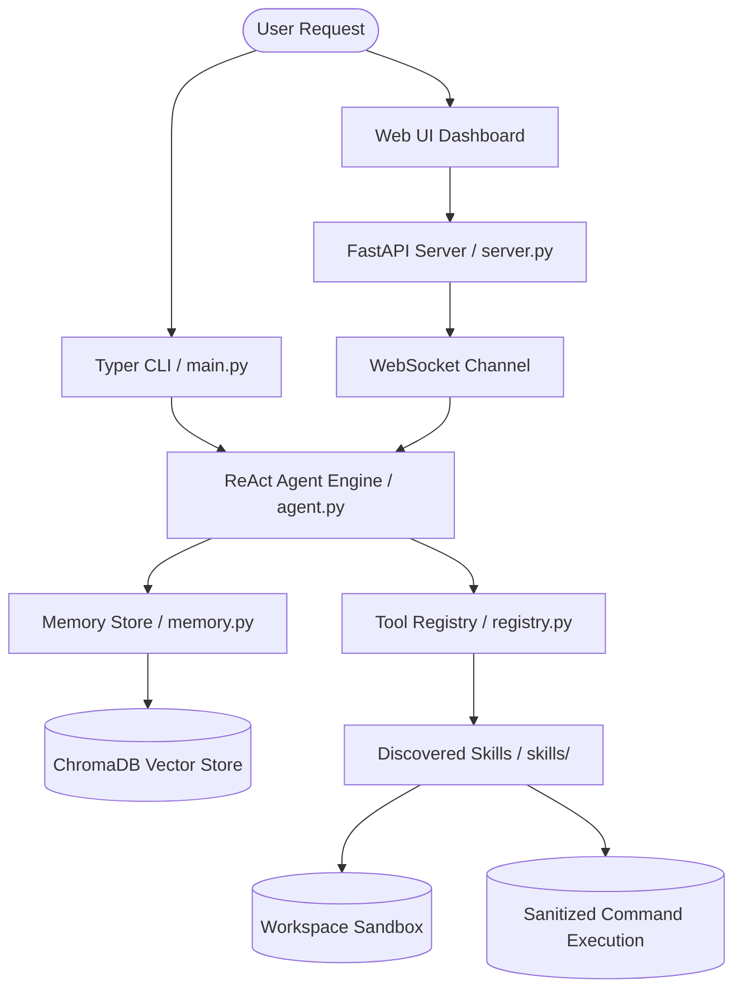

# Architecture Blueprint

Welcome to the architectural specifications of the **Personal AI Agent Assistant**. This document provides a high-level technical overview of the system’s modules, design patterns, and internal data pipelines.

---

## System Overview

The assistant is a strictly local, secure, and extensible autonomous agent. It is designed around the **ReAct (Reasoning and Acting)** framework, supported by a dual-layer memory store and FastAPI-based real-time socket delivery.

---

## 1. Core ReAct Agent Engine (`core/agent.py`)

The reasoning core implements the **ReAct reasoning loop**:
1. **Compilation**: The agent receives a natural-language goal from the user. It queries the Vector Store for relevant historical memories, compiles the dynamic system prompt injecting the context and registered tool schemas, and prepares the input.
2. **Reasoning (Thought)**: The prompt is sent to the configured LLM provider. The agent receives a response containing a `thought` and optionally a structured `action` (tool call) or `final_answer`.
3. **Execution (Act)**: If an `action` is specified, the agent checks if it requires safe-mode user validation. It resolves security scopes and fires the corresponding tool callback.
4. **Observation (Observe)**: The output of the tool is fed back to the agent as a `Tool Result` user observation.
5. **Iteration (Refine)**: Steps 2 through 4 repeat until either the LLM emits a `final_answer` or `max_iterations` is hit.

---

## 2. Memory Architecture & RAG (`core/memory.py`)

The agent possesses two layers of memory:
- **Short-Term Memory**: A fast, in-memory ring-buffer tracking the chat history of the current user session. This ensures context is maintained within a single goal run.
- **Long-Term Memory (RAG)**: A local **ChromaDB** database persisted to `~/.assistant/memory/` and embedded using the fully offline sentence-transformer model `all-MiniLM-L6-v2` (384 dimensions). 
  - **Memory Saving**: Outcome summaries of successful tasks are automatically embedded and saved with `auto_save` tags.
  - **Semantic Context Block**: Before each LLM execution, a top-k similarity query fetches relevant past records and structures them in the system prompt.

---

## 3. Dynamic Tool Registry (`core/registry.py`)

The **Tool Registry** exposes local Python functions to the agent:
- **`@register_tool` Decorator**: Automatically extracts function names, signatures, type-hints, and docstrings to build standard JSON schemas expected by LLMs for function calling.
- **Auto-Discovery**: On start, the registry scans the `skills/` subdirectory, importing all modules not prefixed with an underscore, dynamically populating the available tool list.
- **Destructive Tagging**: Tools marked with `destructive=True` (e.g. `delete_file`, `run_command`) trigger interactive confirmation prompts when `SAFE_MODE=true`.

---

## 4. Concurrent Web Server (`UI/server.py`)

The web server delivers the dashboard using **FastAPI** and **Uvicorn**:
- **Concurrency & Thread Pooling**: Because the agent reasoning loop is synchronous, running it directly in an async route would block the main event loop, halting WebSocket messages. The server runs `Agent.run` inside a thread pool (`fastapi.concurrency.run_in_threadpool`) and uses `asyncio.run_coroutine_threadsafe` to marshal ReAct step events back to the async WebSocket stream loop safely.
- **Client IP-Based Rate Limiting**: REST and WS endpoints are throttled using an in-memory sliding window limiter to prevent API abuse.
- **Security Sandboxing**: Traversal blockers verify that requested log files strictly reside inside the configuration `settings.log_dir`.

---

## 5. Security & Sandbox Boundaries

Security is guaranteed through structural rules:
- **Path Sandboxing (`skills/file_ops.py`)**: Resolves requested paths to absolute paths (`Path.resolve()`) and ensures they remain strictly prefixed by `settings.workspace_dir`. Any file escapes raise a `ValueError` block.
- **Command Sanitization (`skills/system_ops.py`)**: A strict keyword and regex parser filters terminal inputs to deny command chaining containing root elevation (`sudo`), system configuration alterations (`mkfs`), and external paths deletion attempts.
- **Secret Redaction**: JSON log writers recursively redact any occurrence of `settings.api_key` before writing logs to disk.
